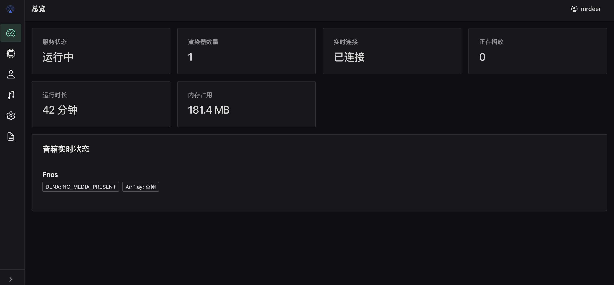

<div align="center">
    <h1>MiAir Next</h1>
    <p><em>🌐 Turn your Xiaomi XiaoAI speaker into a <strong>DLNA renderer</strong>, <strong>AirPlay receiver</strong> and <strong>Spotify Connect device</strong>, with a modern web admin dashboard.</em></p>
    <p>
        <a href="./README.md">简体中文</a> &nbsp;·&nbsp; <a href="./README_en.md">English</a> &nbsp;·&nbsp; <a href="./docs/deployment.md">Deployment Docs</a> &nbsp;·&nbsp; <a href="https://t.me/deerwan">Telegram</a>
    </p>
    <p align="center">
        <a href="https://github.com/deerwan/miair-next/blob/main/LICENSE"></a>
        <a href="https://hub.docker.com/r/mrdeer1997/miair-next"></a>
        <a href="https://github.com/deerwan/miair-next/releases"></a>
        <a href="https://github.com/deerwan/miair-next/stargazers"></a>
        <a href="https://github.com/deerwan/miair-next/network/members"></a>
        <a href="https://t.me/deerwan"></a>
    </p>
</div>

---

# 1. 💡 Introduction

MiAir Next turns your Xiaomi XiaoAI speaker into a **DLNA renderer**, an **AirPlay receiver**, and a **Spotify Connect device**, and ships with a modern web admin dashboard.

Built on top of the protocol layer from [MiAir](https://github.com/KiriChen-Wind/MiAir), the project has been reworked: the backend now uses **FastAPI**, while the frontend is a self-built lightweight admin dashboard with **Vue 3 + Vite + Naive UI**. Multi-architecture Docker images are built in the cloud via GitHub Actions, so you can deploy with a single command.



---

# 2. ✨ Features

Turn your XiaoAI speaker into a **DLNA renderer**, an **AirPlay receiver**, and a **Spotify Connect device**, plus Xiaomi Cloud control, on-screen lyrics/cover, a web admin dashboard, notifications, a tri-state theme, and hot-restart.

> Full feature list: [Features Docs](docs/features.md).

---

# 3. 🚀 Quick Start (Docker, recommended)

> ⚠️ **Host network is required**: DLNA/AirPlay rely on multicast discovery and only support **Linux hosts**.

```bash
curl -fsSL https://raw.githubusercontent.com/deerwan/miair-next/main/install.sh | bash
```

> Full install commands, `docker run` parameters, and first-time setup are in [Quick Start](docs/quickstart.md) and [Deployment & Config](docs/deployment.md).

---

# 4. 📦 Dependencies

The backend is **FastAPI**, the frontend is **Vue 3 + Vite + Naive UI**, and the runtime depends on system components such as `ffmpeg` and `pulseaudio`, plus the on-demand **Spotify Soloist** official binary.

> Full dependency list and purposes: [Dependencies Docs](docs/dependencies.md).

---

# 5. 📚 Documentation

| Doc | Content |
| --- | --- |
| [Features](docs/features.md) | All feature notes: DLNA / AirPlay / Spotify Connect / Xiaomi Cloud / web dashboard |
| [Quick Start](docs/quickstart.md) | Docker one-line install, `docker run` params, first-time setup |
| [Dependencies](docs/dependencies.md) | Runtime dependencies and system components |
| [Deployment & Config](docs/deployment.md) | Install methods, manage.sh scripts, image tags, data dir, env vars, upgrades |
| [Spotify Connect Guide](docs/spotify.md) | Spotify Connect setup, API key, volume model, offline install & troubleshooting |
| [API Docs](docs/api.md) | REST / WebSocket endpoint list, auth notes, quick verification |
| [Local Development](docs/development.md) | Frontend/backend startup, testing, image build, release flow, project structure |

---

# 6. ⚖️ License & Third-Party

## 📄 License

This project is released under **GPL-3.0-or-later**. See [LICENSE](LICENSE) for details.

The protocol engine includes / derives from the following third-party code, each under its own license:

| Component | Source | Original License |
| --- | --- | --- |
| `engine/airplay/fairplay3.py`, `engine/airplay/dxxp.py` | systemcrash (OmgHax) | GPL-2.0 |
| `engine/airplay/server.py`, `pairing/`, `connections/` | [airplay2-receiver](https://github.com/openairplay/airplay2-receiver) (simplified rewrite) | Apache-2.0 |
| `engine/airplay/airplay1.py` | Airport Express public-key implementation | LGPL-2.0+ |
| DLNA / Xiaomi Cloud engine layer | [MiAir](https://github.com/KiriChen-Wind/MiAir) (ported) | MIT |

> The engine mixes both Apache-2.0 and GPL-family code, so the whole is distributed under GPL-3.0-or-later (consistent with [Macast](https://github.com/xfangfang/Macast), which also bundles fairplay3).

---

# 7. 🙏 Acknowledgements

The protocol layer is ported from [MiAir](https://github.com/KiriChen-Wind/MiAir).

Some implementations reference [songloft-plugin-miot](https://github.com/songloft-org/songloft-plugin-miot).

QR-code login references [xiaomusic](https://github.com/hanxi/xiaomusic).

AirPlay metadata parsing references [shairport-sync-metadata-reader](https://github.com/mikebrady/shairport-sync-metadata-reader).

Thanks to the [LINUX DO](https://linux.do/) community.

---

# 8. 👥 Contributors

Thanks to everyone who has contributed code, docs, ideas, and feedback!

[](https://github.com/deerwan/miair-next/graphs/contributors)

---

# 9. ⭐ Star History

**If this project helps you, please consider giving it a Star ⭐. Thank you for your support!**

<a href="https://github.com/deerwan/miair-next">
 <picture>
   <source media="(prefers-color-scheme: dark)" srcset="https://api.star-history.com/svg?repos=deerwan%2Fmiair-next&amp;type=Date&amp;theme=dark" />
   <source media="(prefers-color-scheme: light)" srcset="https://api.star-history.com/svg?repos=deerwan%2Fmiair-next&amp;type=Date" />
   
 </picture>
</a>
