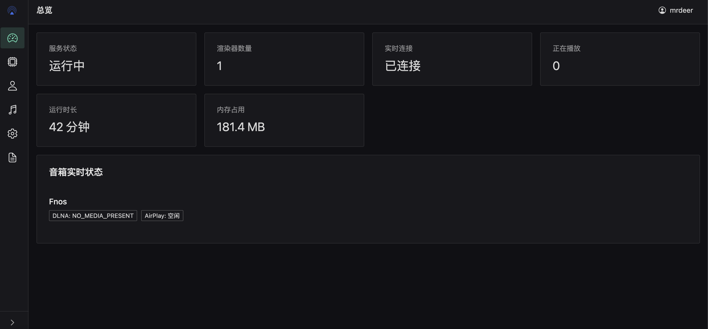

## 一键安装

```bash
curl -fsSL https://raw.githubusercontent.com/deerwan/miair-next/main/install.sh | bash
```

::: warning 部署前提
DLNA / AirPlay 依赖组播发现，**必须使用 host 网络**，仅支持 **Linux 宿主机**（macOS / Windows 的 Docker Desktop 不支持 host 网络组播）。详见[部署与配置](/deployment)。
:::

## 管理后台预览



## Star 趋势

如果这个项目对您有所帮助，欢迎点亮一个 Star ⭐，感谢您的支持！

<picture>
  <source media="(prefers-color-scheme: dark)" srcset="https://api.star-history.com/svg?repos=deerwan%2Fmiair-next&amp;type=Date&amp;theme=dark" />
  <source media="(prefers-color-scheme: light)" srcset="https://api.star-history.com/svg?repos=deerwan%2Fmiair-next&amp;type=Date" />
  
</picture>
