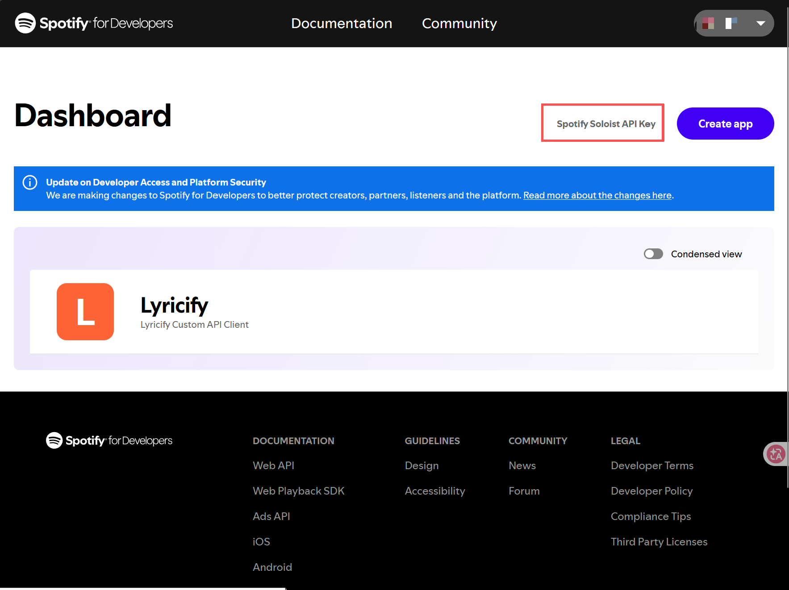
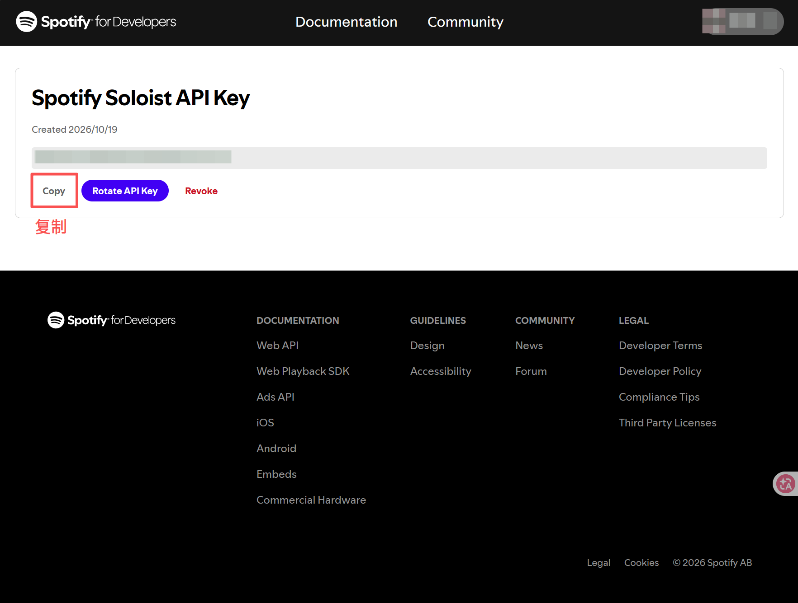

# Spotify 畅联 (Spotify Connect) 指南

本项目内置了对 Spotify 官方 **Soloist** 客户端的原生支持，可将小米小爱音箱注册为标准 **Spotify Connect** 设备。手机、平板、电脑端 Spotify App 均可将其作为投送目标，实现无损拉流、即时控制与曲目展示。

---

## 一、功能特性

- **官方 Soloist 引擎集成**：采用 Spotify 官方推出的嵌入式 Soloist 客户端，连接稳定、延迟低，原生支持 Spotify 官方协议与高码率播放。
- **支持跨网远程音乐控制**：不同于 DLNA 与 AirPlay 强依赖局域网组播广播（UDP 1900 / 5353），Spotify Connect 依托 Spotify 全球云端会话同步体系；初次配对后，手机或平板无论连接蜂窝移动网络（4G/5G）还是异地 Wi-Fi，只要登录同一 Spotify 账号，设备列表中均能直接唤醒家中音箱并跨网络投送播放、切歌与无损调音。
- **自动生命周期管理**：遵循 Spotify 开发者条款，Soloist 二进制在首次启用时按运行架构（`x86_64` / `arm64` / `arm32`）从 Spotify 官方 CDN 自动下载至数据目录（不内置打包于 Docker 镜像）；支持 90 天构建到期自动下载最新版本热更新，亦可在管理后台手动一键更新。
- **活动设备门控 (Active Device Gating)**：精确跟踪 Spotify Connect 设备状态，仅当本机被选为当前活跃播放设备时才向音箱推流；局域网内其他设备播放时不产生误触，播放转移到其他设备或退出登录时即时切断推流。
- **与「播放行为」联动**：遵循「系统设置 → 播放行为 → 被打断后自动恢复」：
  - **开启**：检测到打断后，等待「恢复延迟 (秒)」作为确认窗口；仍处于打断状态则重新推流；
  - **关闭**：同样等待「恢复延迟 (秒)」确认后，停止本地推流、恢复默认音量并暂停 Spotify；
  - **米家暂停**：按上述开关处理（开启续播 / 关闭暂停）；程序不监听米家云返回的 playing 状态作为续播触发信号。
- **专业级音量控制模型**：
  - **开播音量**：开播初始音量遵循「系统设置 → 播放行为 → 默认音量」；
  - **客户端线性调音**：开播后音箱硬件音量提升至 100%，由 Spotify App 音量滑杆进行软件级线性调音（0% - 100%），与手机/电脑听感 1:1 契合且避免双重衰减；
  - **闲置保护**：暂停或断开连接后，音箱硬件音量自动还原为默认音量，防止其他场景闲置爆音。
- **触屏歌词与专辑封面**：推流期间自动解析 Spotify 曲目元数据并智能检索小米音乐曲库换取 `audioID`，触屏/带屏音箱可同步显示高清封面与滚动歌词。
- **全方位 Web 监控与控制**：
  - **总览看板**：WebSocket 毫秒级推送 Spotify 当前播放状态、歌曲标题与艺术家；
  - **设备管理**：列表直观展示 Spotify 绑定音箱、在线状态、配对状态与播放标签；
  - **系统设置**：提供运行状态检测（Soloist 版本、构建到期倒计时）、配对引导与接收器独立热重启。

---

## 二、前置准备

1. **Spotify Premium 账号**：Spotify 官方规定使用 Spotify Connect / Soloist 需要有效的 Premium 订阅。
2. **获取 Soloist API Key**：
   - 登录 [Spotify for Developers Dashboard](https://developer.spotify.com/dashboard)；
   - 点击进入 **Spotify Soloist API Key** 页面；
       
   - 生成并复制您的专用 API Key。
       


> ⚠️ **安全提示**：每个部署者应当自行生成独立的 API Key，请勿与他人共享。Key 在保存后仅持久化于本机 `conf/config.json`（权限 600），管理接口传输与展示均已执行脱敏处理。

---

## 三、快速配置与配对

#### 完成小米账号和音响的绑定后再操作

1. **进入管理后台**：浏览器打开管理面板（默认 `http://<宿主机IP>:8300`），进入「系统设置」→「Spotify 畅联」标签页；
2. **配置参数**：
   - **启用 Spotify 畅联**：开启开关；
   - **Spotify 设备名**：自定义在 Spotify App 设备列表中显示的名称（留空则默认使用目标音箱名称）；
   - **目标音箱**：下拉选择一台接收音频的小爱音箱（单实例绑定一台音箱；留空则默认使用第一台在线音箱）；
   - **Soloist API Key**：粘贴您在 Spotify 开发者后台获取的 Key；
3. **保存生效**：点击「保存设置」，系统将在后台下载并热启动 Soloist 接收器；
4. **设备配对**：
   - 打开手机或电脑端 **Spotify App**；
   - 点击播放控制栏的「可用设备」图标；
   - 在设备列表中找到您设置的设备名称并点击连接，即可完成初次配对；
   - 配对成功后凭据将自动持久化于 `data/spotify/state/`，后续容器重启无需重新配对。

---

## 四、底层音频架构

Soloist 官方仅支持通过 PipeWire 或 PulseAudio 输出音频，不支持直接管道输出。为保持宿主机系统整洁，本项目采用完全自包含的虚拟音频链路：

```text
Spotify App (手机/电脑)
       │  (Spotify Connect 协议)
       ▼
Spotify Soloist (官方客户端进程)
       │  (UNIX Socket: /tmp/miair-spotify-pulse/native)
       ▼
PulseAudio 虚拟音频服务 (容器内独立守护进程)
       │  (null-sink monitor 虚拟输出采集)
       ▼
parec (PCM s16le / 44100Hz / 2ch 流式捕获)
       │  (高抗抖动缓冲队列)
       ▼
AudioStreamServer (本地 HTTP WAV 音频流服务)
       │  (局域网 HTTP 拉流)
       ▼
小米小爱音箱 (play_url 播放)
```

- 容器内独立运行 PulseAudio 服务，无需宿主机具备物理声卡或配置音频驱动；
- 虚拟输出与采集文件放置在临时目录（`/tmp`），避免容器降权后影响宿主机挂载数据目录的文件权限。

---

## 五、离线与手动安装（受限网络备选）

若部署环境无法直接访问 Spotify 官方 CDN，可手动下载对应 CPU 架构的可执行文件放置到数据目录中：

### 1. 官方 CDN 下载地址

| 架构 (`uname -m`) | 下载地址 |
| --- | --- |
| `x86_64` / `amd64` | `https://soloist-builds.spotifycdn.com/soloist_release_x86_64.tar.gz` |
| `aarch64` / `arm64` | `https://soloist-builds.spotifycdn.com/soloist_release_arm64.tar.gz` |
| `armv7l` / `armv6l` | `https://soloist-builds.spotifycdn.com/soloist_release_arm32.tar.gz` |

### 2. 手动安装步骤

解压压缩包后，将得到的 `soloist` 二进制文件放置于宿主机数据目录的对应位置，并授予执行权限：

```bash
# 假设数据目录为 ./data
mkdir -p data/spotify/bin
cp soloist data/spotify/bin/soloist
chmod 755 data/spotify/bin/soloist
```

放置完成后，在 Web 后台点击「重启 Spotify」即可立即识别并加载。

---

## 六、常见问题与排错

### 1. Spotify App 设备列表中找不到小爱音箱？
- 确认手机/电脑与运行 MiAir Next 的宿主机位于**同一局域网网段**；
- 确认在「系统设置 → Spotify 畅联」中已启用并正确填写了有效的 API Key；
- 检查运行状态中的「Soloist 版本」与「运行状态」是否为“运行中”；若显示错误信息，根据提示检查 Key 格式或网络连通性；
- 点击面板上的「配对引导」获取提示，或者点击「重启 Spotify」刷新服务。

### 2. 为什么提示构建已过期或退出码为 10？
Spotify 官方对 Soloist 客户端设置了 **90 天构建有效期**（以保证客户端安全与协议兼容性）。到期后程序会自动尝试重新下载最新构建并无缝热重启。您也可以随时在管理后台点击「更新 Soloist」主动触发升级。

### 3. 可以将 Spotify 投送到多台小爱音箱吗？
Spotify Soloist 单个客户端实例设计为一对一绑定单一音箱设备。若需要切换播放音箱，只需在「系统设置 → Spotify 畅联」中更改「目标音箱」并保存即可。

### 4. 为什么小爱音箱播放在其他设备切歌时被停掉了？
这是**活动设备门控**的正常预期表现。当您在手机或电脑本地扬声器播放时，Spotify Connect 会广播播放状态，程序会自动识别到当前小爱音箱并非活动目标，从而避免音箱与个人设备争抢声音。一旦在 App 设备列表中切回小爱音箱，推流将立即恢复。
